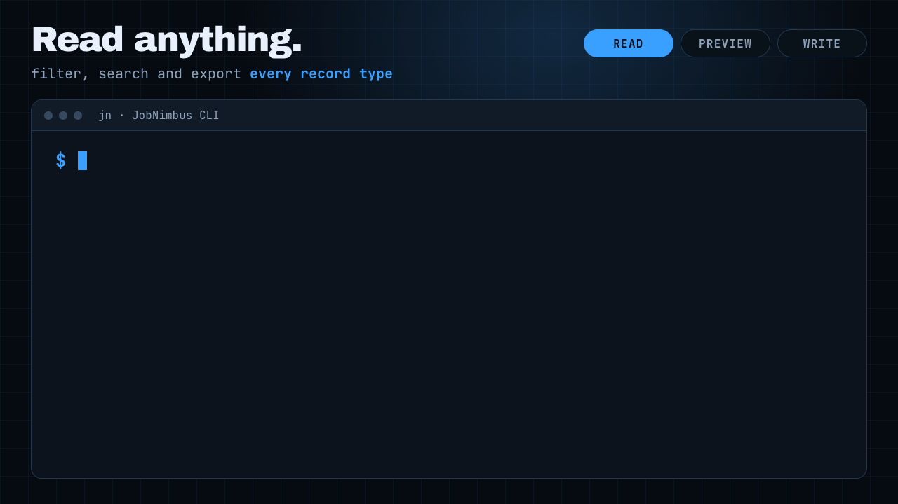

<p align="center">
  
</p>

<h1 align="center">JobNimbus CLI</h1>

<p align="center">
  <strong>Agent-native CLI for reading and writing everything in a JobNimbus CRM account.</strong><br>
  Built for AI agents to query, create, update and soft-delete contacts, jobs, tasks, notes, invoices, estimates, products, orders and files — with a dry-run preview and a read-only lock.
</p>

<p align="center">
  The installer can also add a ready-to-use skill for Claude, Codex, and OpenClaw.<br>
  You can review that skill here: <a href="agent-harness/cli_anything/jobnimbus/skills/SKILL.md">SKILL.md</a>
</p>

<p align="center">
  
  
  
</p>

<p align="center">
  
</p>

---

> **Not read-only any more.** The repository is still named `jobnimbus-read-cli`, but since v0.3.0 `jn` also creates, updates and soft-deletes records. Set `JOBNIMBUS_READ_ONLY=1` to get the old read-only behaviour.

## Why

JobNimbus has no built-in CLI. This tool lets AI agents (or humans) work the full JobNimbus public API from the terminal: structured JSON output, filtering, pagination, bulk export, and create / update / delete on every record type the API can write.

## One-Line Install

### CLI Only (macOS / Linux)

```bash
git clone https://github.com/Cryptic0011/jobnimbus-read-cli.git && cd jobnimbus-read-cli && ./install.sh
```

### Agent Installs (macOS / Linux)

These use the same installer on purpose. The difference is which agent you already have on your machine.

**Claude Code**

```bash
git clone https://github.com/Cryptic0011/jobnimbus-read-cli.git && cd jobnimbus-read-cli && ./install.sh
```

**Codex**

```bash
git clone https://github.com/Cryptic0011/jobnimbus-read-cli.git && cd jobnimbus-read-cli && ./install.sh
```

**OpenClaw**

```bash
git clone https://github.com/Cryptic0011/jobnimbus-read-cli.git && cd jobnimbus-read-cli && ./install.sh
```

### Windows (PowerShell)

```powershell
git clone https://github.com/Cryptic0011/jobnimbus-read-cli.git; cd jobnimbus-read-cli; powershell -ExecutionPolicy Bypass -File .\install.ps1
```

For normal CLI users, the installer just gives you a global `jn` command.

For Claude/Codex/OpenClaw users, the same installer also handles agent setup when it finds that agent's home directory.

The installer:
- Installs `jn` as a user-level Python command with `pip install --user`
- Copies the skill into `~/.claude/skills/` if `~/.claude` exists
- Copies the skill into `${CODEX_HOME:-~/.codex}/skills/` if Codex is installed
- Copies the skill into `~/.openclaw/skills/` if OpenClaw is installed
- Tells you if your Python user `bin` directory still needs to be added to `PATH`

## Set Your API Key

**macOS/Linux** — add to `~/.zshrc` or `~/.bashrc`:
```bash
export JOBNIMBUS_API_KEY="your-api-key"
```

**Windows PowerShell:**
```powershell
[System.Environment]::SetEnvironmentVariable("JOBNIMBUS_API_KEY", "your-api-key", "User")
```

**Claude Code** — add to `~/.claude/settings.json`:
```json
{
  "env": {
    "JOBNIMBUS_API_KEY": "your-api-key"
  }
}
```

**OpenClaw** — add to `~/.openclaw/openclaw.json`:
```json
{
  "env": {
    "JOBNIMBUS_API_KEY": "your-api-key"
  }
}
```

Get your API key from JobNimbus: **Settings > API Keys**.

## Quick Start

```bash
# Account overview
jn summary

# List recent contacts
jn contacts list --size=10

# Search jobs
jn jobs search "status_name:Completed"

# Find open invoices
jn --json invoices search "status_name:Open"

# Pull everything for a contact
jn --json related CONTACT_JNID

# Export all notes as JSONL
jn export activities --query="record_type_name:Note" > notes.jsonl

# Preview a write, then do it
jn --dry-run contacts update CONTACT_JNID --set status_name="Appointment Booked"
jn contacts update CONTACT_JNID --set status_name="Appointment Booked"

# Add a note to a contact or job
jn activities add-note JNID "Left a voicemail"
```

## Commands

| Command | Description |
|---------|-------------|
| `jn contacts` | Customers, leads, companies |
| `jn jobs` | Projects, work orders |
| `jn tasks` | To-dos, assignments |
| `jn activities` | Notes, emails, calls, audit trail |
| `jn invoices` | Billing, line items, payment status |
| `jn estimates` | Quotes, proposals |
| `jn products` | Material/labor catalog, pricing |
| `jn files` | Documents, photos, attachments (`download`, `upload`) |
| `jn materialorders` / `jn workorders` | Material and work orders |
| `jn payments` / `jn creditmemos` | Payments and credit memos (read) |
| `jn workflows` | Pipeline stages, statuses, account settings |
| `jn api METHOD PATH` | Any other endpoint (users, UoMs, account setup, payments) |
| `jn find <JNID>` | Auto-detect resource type |
| `jn related <JNID>` | All records for a contact/job |
| `jn export <resource>` | Bulk JSONL with auto-pagination |
| `jn summary` | Record counts for all resources |
| `jn repl` | Interactive session |

Every resource supports `list`, `get`, `count`, and `search`.

Writes, where the JobNimbus API allows them:
- `create`, `update`, `delete` on contacts, jobs, tasks, invoices, estimates, products, materialorders, workorders
- `activities create` / `add-note` / `update`
- `files upload` / `update`

`delete` is a soft delete (`is_active=false`), needs `--yes`, and is undone with `update JNID --set is_active:=true`.

## Common Options

```
--json              Output raw JSON (for agents)          [global, before the command]
--dry-run           Print a write request, send nothing   [global]
--read-only         Block all writes                      [global]
--actor EMAIL       Act as this JobNimbus user            [global]
--size N            Records per page (max 1000)
--offset N          Pagination offset (max 9999; use export beyond that)
--sort-field F      Sort by field (default: date_updated)
--sort-dir asc|desc Sort direction (default: desc)
--query Q           Query (see below)
--filter JSON       Raw JobNimbus filter JSON
--fields F          Comma-separated fields (saves tokens)
--columns F         Custom table columns
--set KEY=VALUE     Field for create/update (KEY:=JSON for non-strings)
--data JSON|@file|- Whole body for create/update
```

## Query Syntax

`--query` / `search` take a small query language that is translated into the API's `filter` JSON:

```bash
# Field match
jn contacts search "status_name:Lead"

# Wildcards
jn jobs search "name:*Smith*"

# Boolean
jn contacts search "city:Miami AND state_text:FL"

# Range
jn invoices search "total:[1000 TO *]"

# Negation, multi-word values
jn contacts search 'city:Orlando AND NOT status_name:"Lost Lead"'
```

AND and OR cannot be mixed and parentheses are not supported — those queries fail with an error instead of being ignored. Use `--filter` with raw JSON for anything more complex.

## Agent Usage

Agents get their instructions from two places:

- **[SKILL.md](agent-harness/cli_anything/jobnimbus/skills/SKILL.md)** — the full command reference and the rules for writing safely. The installer copies it into Claude, Codex and OpenClaw when those are already on your machine.
- **[AGENTS.md](AGENTS.md)** — a short pointer at the repo root for agents that work from a clone (Cursor, Gemini CLI, OpenCode and others).

For agent use, make sure:
- `jn` works in a fresh terminal
- `JOBNIMBUS_API_KEY` is set in the environment the agent will run with
- `JOBNIMBUS_READ_ONLY=1` is set for any agent that should only look, never change

Just talk naturally:
- *"How many open invoices do I have in JobNimbus?"*
- *"Pull all activity notes for contact JNID123"*
- *"Move the Kent job to Completed and add a note that the final check cleared"*
- *"Create a follow-up task for Sam on Thursday for this contact"*
- *"Show me what you would change first"* (the agent runs it with `--dry-run`)

## Write Safety

- `--dry-run` prints the exact request (method, URL, body) without sending it.
- `--read-only` or `JOBNIMBUS_READ_ONLY=1` blocks every POST and PUT. Set it for agents that should only audit.
- `delete` requires `--yes` and is a soft delete.
- Writes are never retried after a timeout, so nothing is created twice.
- The API key is only ever sent to `*.jobnimbus.com`.
- What a key may change is ultimately set by its JobNimbus access profile (Settings > API).

## Tests

```bash
cd agent-harness

# Unit tests (no API key, no network)
python3 -m pytest cli_anything/jobnimbus/tests --ignore=cli_anything/jobnimbus/tests/test_full_e2e.py

# E2E tests (requires API key; read-only, never writes)
export JOBNIMBUS_API_KEY="your-key"
python3 -m pytest cli_anything/jobnimbus/tests/test_full_e2e.py
```

## License

No license file has been added yet. Until one is added, treat the code as all rights reserved.
